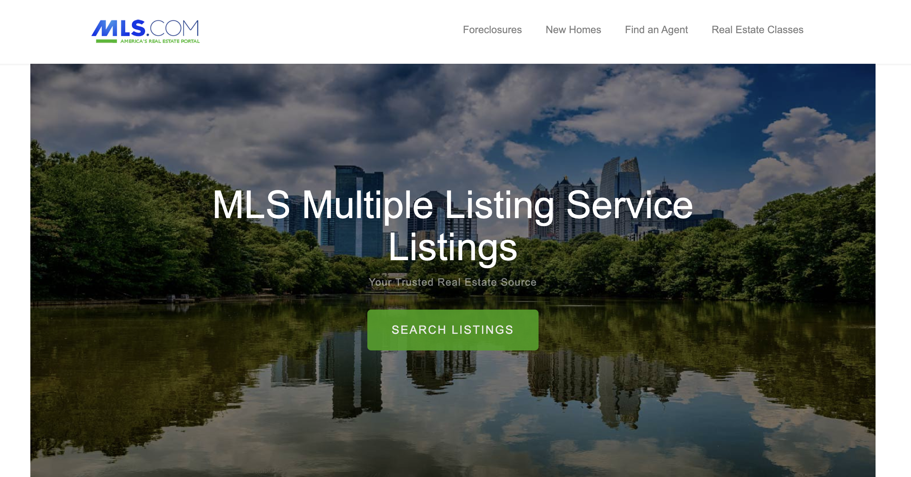
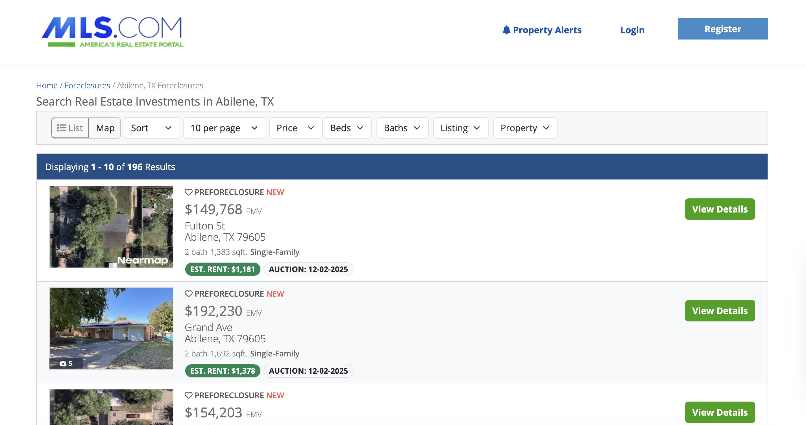
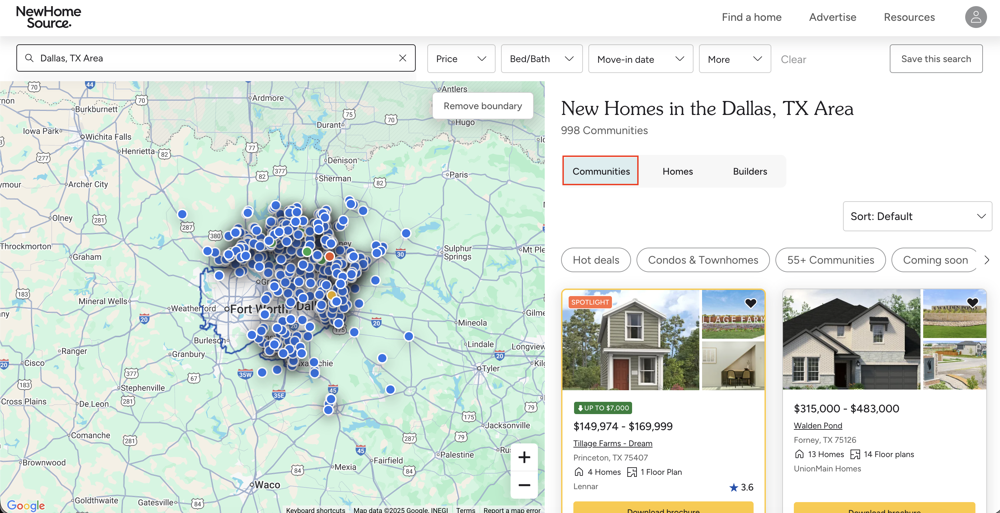
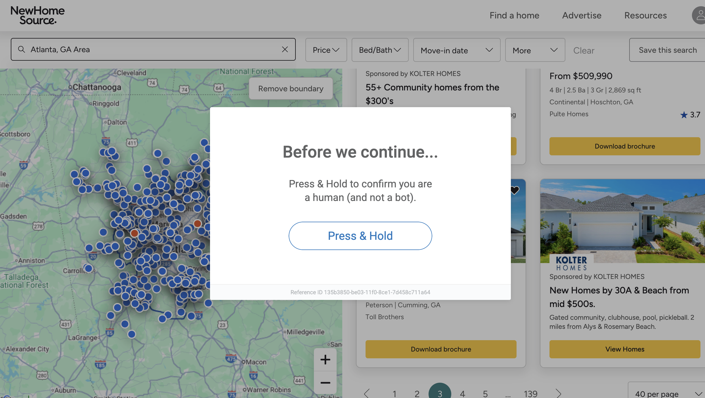
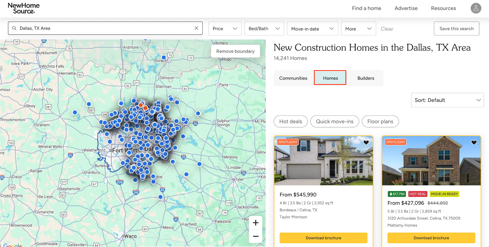

# MLS 房地产数据抓取工具
本仓库提供用于从 MLS 门户提取公开房地产数据的 Python 爬虫工具。由于 MLS 关联网站采用了强大的反爬虫防御措施，包括基于 IP 的速率限制、浏览器指纹识别和 CAPTCHA，因此访问这些网站并不容易。本项目采用逐级增强的策略，从 HTTP 抓取工具到托管式浏览器解决方案，以绕过这些防御并扩展数据提取规模。



## 目录

- [这些数据为何重要](#这些数据为何重要)
- [安装](#安装)
- [第 1 部分：首次抓取](#第-1-部分首次抓取止赎房产)
- [第 2 部分：绕过 IP 和浏览器封锁](#第-2-部分第一堵墙绕过-ip-和浏览器封锁)
- [第 3 部分：本地 Playwright 为何会失败](#第-3-部分那堵墙本地-playwright-为何会失败)
- [第 4 部分：处理 JavaScript 和 CAPTCHA](#第-4-部分处理-javascript-和交互式-captcha)
- [选择适合你的方案](#选择适合你的方案自建还是购买)

## 这些数据为何重要

这些公开的 MLS 数据是制定任何严谨房地产策略的基础材料。团队可使用这些数据：

- **分析市场趋势。** 识别价格变化、在售天数和库存水平。
- **构建投资模型。** 发现并评估止赎房产或新建项目机会。
- **开展竞争情报分析。** 实时了解其他开发商和中介机构正在发布哪些房源。

## 目标网站
- [mls.foreclosure.com](https://mls.foreclosure.com/)（用于获取止赎房源）
- [newhomesource.com](https://www.newhomesource.com/)（用于获取新社区和新房源）

## 技术栈
- **Python 3.10+**
- **curl_cffi**：一个可模拟浏览器 TLS/JA3 指纹的 Python 客户端
- **BeautifulSoup 4**：用于解析静态 HTML
- **Playwright**：用于自动执行浏览器操作并处理由 JavaScript 渲染的内容
- [**Bright Data**](https://www.bright.cn/)：提供用于规模化抓取的解锁基础设施（住宅代理和 Browser API）

## 安装

1. 克隆仓库：
```bash
git clone https://github.com/bright-cn/mls-scraper.git
cd mls-scraper
```

2. 安装 Python 依赖项：
```bash
pip install -r requirements.txt
```

3. 安装 Playwright 浏览器：
```bash
playwright install
```

4. 创建凭据文件。在项目根目录中创建一个名为 `.env` 的文件。我们将在第 2 部分和第 4 部分向此文件添加凭据。

## 第 1 部分：首次抓取（止赎房产）

我们从一个简单的目标 [mls.foreclosure.com](https://mls.foreclosure.com/) 开始，获取第一个数据集并介绍主要使用的 HTTP 库。

### 工具：curl_cffi
我们将使用 _curl_cffi_ 发送所有 HTTP 请求。虽然第一个目标较为简单，但从一开始就使用 *curl_cffi*，可让我们始终以一致的方式进行基本浏览器模拟。这项强大功能对于下一个目标至关重要。

如需了解更多信息，可以阅读这篇 [curl_cffi 网页爬虫指南](https://www.bright.cn/blog/web-data/web-scraping-with-curl-cffi)。



关键代码片段（*scrapers/foreclosures.py*）：

```python
from curl_cffi import requests

def fetch_html(url):
    """
    Fetch HTML content using curl_cffi to impersonate a browser.
    """
    try:
        response = requests.get(
            url,
            timeout=30,
            impersonate="chrome", # The key to bypassing TLS fingerprinting
            verify=False
        )
        response.raise_for_status()
        return response.text
    # ... (error handling)
```

此脚本可以成功处理分页并提取关键信息。[在此查看完整脚本](https://github.com/bright-cn/mls-scraper/blob/main/scrapers/foreclosures.py)。

### 使用方法
```bash
python3 scrapers/foreclosures.py \
  --url "https://mls.foreclosure.com/listing/search.html?ci=abilene&st=tx" \
  --max-pages 5 \
  --output data/foreclosure_data.json
```

查找 URL：前往 [https://mls.foreclosure.com](https://mls.foreclosure.com/)，执行搜索（例如“Abilene, TX”），然后从浏览器复制 URL。

输出示例（*data/foreclosures.json*）：
```json
[
  {
    "listing_type": "Preforeclosure",
    "price": "$154,203",
    "price_type": "EMV",
    "street": "Meadowbrook Dr",
    "city": "Abilene",
    "state": "TX",
    "zip_code": "79603",
    "bathrooms": "2",
    "square_feet": "1,771",
    "property_type": "Single-Family",
    "estimated_rent": "$1,281",
    "auction_date": "01-06-2026",
    "listing_id": "64404928",
    "image_url": "https://dlvp94zy6vayf.cloudfront.net/listingphoto/..."
  }
]
```

[在此查看完整输出示例](https://github.com/bright-cn/mls-scraper/blob/main/data/foreclosures.json)。

**要点**：此脚本可以完美处理这个简单网站。接下来，让我们看看对更高级的目标使用此脚本会发生什么。

## 第 2 部分：第一堵墙（绕过 IP 和浏览器封锁）
现在，我们将目标转向 *newhomesource.com* 上的“Communities”选项卡。这个网站更为复杂。



### 挑战：IP 与指纹封锁
运行第 1 部分中的脚本会立即失败，因为该网站部署了多层保护：
1. **基于 IP 的速率限制。** 发出 2 到 3 个请求后，我们的单一 IP 就会被标记并封锁。
2. **浏览器指纹识别。** 服务器会检查我们的 TLS/JA3 网络特征。简单脚本会立即被识别为爬虫。



### 解决方案：curl_cffi 模拟和 Bright Data 代理
解决方法如下：
1. **保持浏览器模拟。** 我们的 *curl_cffi* 脚本已经使用 `impersonate="chrome"`。这对于绕过服务器的浏览器指纹识别至关重要。
2. **添加住宅代理。** 我们将集成 [Bright Data 的住宅代理网络](https://www.bright.cn/proxy-types/residential-proxies)，在每次请求时轮换 IP 地址，从而绕过速率限制。

设置代理区域：
- 在 Bright Data 控制面板中，前往“Proxies and Scraping”。
- 点击“住宅代理”下方的“Get started”。
- 为区域命名（例如 *mls_scraper_proxy*），然后点击“Add”。
- 点击区域名称，查找你的 *Host*、*Port*、*Username* 和 *Password*。

将凭据添加到 *.env*：直接打开已创建的 *.env* 文件，然后添加代理凭据。
```bash
# Bright Data Proxy Configuration
BRIGHTDATA_PROXY_HOST=brd.superproxy.io:port
BRIGHTDATA_PROXY_USER=your-proxy-username
BRIGHTDATA_PROXY_PASS=your-proxy-password
```

关键代码片段（*scrapers/communities.py*）：
```python
import os
from curl_cffi import requests
from dotenv import load_dotenv
load_dotenv() 

def fetch_html(url):
    # ...
    proxy_host = os.getenv('BRIGHTDATA_PROXY_HOST')
    # ...
    proxies = { 'https': proxy_url }
    try:
        response = requests.get(
            url,
            proxies=proxies,          # Solution 1: Add proxies
            timeout=30,
            verify=False,
            impersonate="chrome"      # Solution 2: Activate impersonation
        )
    # ...
```
[在此查看完整脚本](https://github.com/bright-cn/mls-scraper/blob/main/scrapers/communities.py)。

### 使用方法
```bash
python3 scrapers/communities.py \
  --url "https://www.newhomesource.com/communities/ga/atlanta-area" \
  --max-pages 10 \
  --output data/communities.json
```
查找 URL：前往 [newhomesource.com](https://www.newhomesource.com/)，搜索城市，然后复制 URL。

输出示例（*data/communities.json*）：
```json
[
  {
    "community_id": "201913",
    "community_name": "Hemingway - Reserve Series",
    "city": "Cumming",
    "state": "GA",
    "zip_code": "30041",
    "latitude": "34.279387",
    "longitude": "-84.070156",
    "price_low": "468033",
    "price_high": "585990",
    "builder_name": "Meritage Homes",
    "market_name": "Atlanta",
    "phone_number": "888-842-4527",
    "primary_image": "https://nhs-dynamic-secure.akamaized.net/...",
    "url": "https://www.newhomesource.com/community/ga/cumming/...",
    "num_homes": "8",
    "num_floor_plans": "7"
  }
]
```
[在此查看完整输出示例](https://github.com/bright-cn/mls-scraper/blob/main/data/communities.json)。

**要点**：此设置可以攻克 IP 和浏览器指纹识别。但如果网站依赖 JavaScript 和交互式 CAPTCHA，又会发生什么？

## 第 3 部分：那堵“墙”（本地 Playwright 为何会失败）

第 2 部分中的 HTTP 抓取工具无法处理“Homes”选项卡，因为它需要 JavaScript 并且必须点击按钮。

合乎逻辑的下一步，也是大多数开发者会尝试的方法，是将本地 Playwright 浏览器与住宅代理结合使用。

这就是我们一直在讨论的那堵“墙”。

我们已经提供了采用这一方法的脚本：[scrapers/homes_proxy.py](https://github.com/bright-cn/mls-scraper/blob/main/scrapers/homes_proxy.py)

**现在就运行它。**

你会看到它运行失败，理解其*原因*至关重要。该脚本会立即被标记，并收到严苛的“Press and Hold”CAPTCHA 验证。

这就是**浏览器完整性问题。**

服务器的反爬虫脚本并不关心你的 IP（那是第 2 部分的问题）。它现在分析的是*浏览器指纹*。它会立即检测到标准自动化工具的“破绽”（webdriver 标志、字体不一致、GPU 渲染等），并在你抓取任何内容之前将其封锁。

因此，即使配备优质代理，本地 Playwright 脚本对这个目标而言也是一条死路。

接下来，让我们攻克最后这堵墙。

## 第 4 部分：处理 JavaScript 和交互式 CAPTCHA

现在，我们将目标转向最困难的部分：*newhomesource.com* 上的“Homes”选项卡。



### 解决方案：Bright Data Browser API
[Bright Data Browser API](https://www.bright.cn/products/scraping-browser) 专为解决这种浏览器完整性问题而设计。

它不只是在代理上运行 Playwright，而是一款托管于云端、在指纹层面模拟真人的浏览器。它会自动管理我们提到的所有底层不一致问题（`webdriver` 标志、字体、GPU 渲染等），并在发出请求之前集成解锁功能。

因此，我们可以连接到该浏览器并使用标准 Playwright 脚本，而 API 会在后台处理所有复杂的解锁和验证码破解工作。

设置 Browser API 区域：

- 按照 [Browser API 快速入门指南](https://docs.brightdata.com/scraping-automation/scraping-browser/quickstart)创建新的 Browser API 区域。
- 创建后，点击区域名称，查找你的 *Host*、_Port_、*Username* 和 *Password*。

将凭据添加到 *.env*：

打开 *.env* 文件并添加这些新凭据。
```bash
# ... (Proxy credentials from Part 2)

# Bright Data Browser API Configuration
BRIGHTDATA_BROWSER_HOST=brd.superproxy.io:port
BRIGHTDATA_BROWSER_USER=your-browser-username
BRIGHTDATA_BROWSER_PASS=your-browser-password
```

关键代码片段（*scrapers/homes_browser.py*）：

此脚本使用标准 Playwright API。唯一的区别是，我们不会启动本地且可被检测到的浏览器，而是使用 *connect_over_cdp* 连接到 Bright Data 的远程、不可封锁浏览器。
```python
import os
from playwright.sync_api import sync_playwright
from dotenv import load_dotenv

load_dotenv()

def scrape_all_pages(base_url, max_pages=None):
    # ...
    
    # Load Browser API credentials
    browser_host = os.getenv('BRIGHTDATA_BROWSER_HOST')
    browser_user = os.getenv('BRIGHTDATA_BROWSER_USER')
    browser_pass = os.getenv('BRIGHTDATA_BROWSER_PASS')
    
    auth = f"{browser_user}:{browser_pass}"
    brd_connection_string = f"wss://{auth}@{browser_host}"

    with sync_playwright() as p:
        try:
            logger.info("Connecting to Bright Data Browser API...")
            # Connect to the remote, unblockable browser
            browser = p.chromium.connect_over_cdp(
                brd_connection_string,
                timeout=60000
            )
            
            # --- From here, it's just standard Playwright automation ---
            context = browser.new_context(ignore_https_errors=True)
            page = context.new_page()

            page.goto(base_url, wait_until="domcontentloaded", timeout=60000)

            # 1. Click the "Homes" tab
            page.click('a[data-qa="filters-result-type-homes"]')
            
            # ... (parsing logic) ...
            
            # 2. Loop through all pages by clicking "Next"
            for page_num in range(2, total_pages + 1):
                page.click('button[data-next]') # <-- AUTOMATION
                # ...
```

[在此查看完整脚本](https://github.com/bright-cn/mls-scraper/blob/main/scrapers/homes_browser.py)。

### 使用方法
```bash
python3 scrapers/homes_browser.py \
  --url "https://www.newhomesource.com/communities/ga/atlanta-area#home-listings" \
  --max-pages 5 \
  --output data/homes_browser.json
```

查找 URL：前往 [newhomesource.com](https://www.newhomesource.com/)，搜索城市，点击“Homes”选项卡，然后复制 URL。

输出示例（*data/homes_browser.json*）：
```json
[
  {
    "plan_id": "3180088",
    "listing_type": "plan",
    "community_name": "Rosewood Farm",
    "plan_name": "Reynolds",
    "builder_name": "Taylor Morrison",
    "city": "Lawrenceville",
    "state": "GA",
    "zip_code": "30044",
    "price_raw": "$424,990",
    "home_status": "Ready to build",
    "bedrooms": "4",
    "bathrooms": "3.5",
    "garages": "2",
    "sq_ft": "2375",
    "url": "https://www.newhomesource.com/plan/reynolds-taylor-morrison-..."
  }
]
```

[在此查看完整输出示例](https://github.com/bright-cn/mls-scraper/blob/main/data/homes_browser.json)。

## 选择适合你的方案：“自建还是购买”

对于希望专注于数据分析而非维护爬虫工具的团队，Bright Data 提供两种托管式方案。

### 1. 低代码方案：网页爬虫 IDE
适合希望自行编写解析逻辑（使用 JavaScript），但将所有基础设施、代理管理和解锁工作交由平台处理的开发者。[网页爬虫 IDE](https://www.bright.cn/products/web-scraper/functions) 是一个基于云的无服务器环境，Bright Data 会为你处理所有扩展、调度和解锁工作。

### 2. 无代码方案：请求定制抓取工具
适合只想获取最终整洁数据的团队或个人。你可以[请求定制抓取工具](https://www.bright.cn/products/web-scraper/studio)，Bright Data 团队会为你构建、运行和维护爬虫，并按你的计划交付数据。

以下是最终对比，可帮助你为项目选择合适的解决方案：

| | 第 1 部分：简单抓取 | 第 2 部分：IP/浏览器封锁 | 第 4 部分：JS/CAPTCHA 墙 | 托管式方案（购买） |
| --- | --- | --- | --- | --- |
| 使用的工具 | *curl_cffi* | *curl_cffi* + [住宅代理](https://www.bright.cn/proxy-types/residential-proxies) | *Playwright* + [Browser API](https://www.bright.cn/products/scraping-browser) | [网页爬虫 IDE](https://www.bright.cn/products/web-scraper/functions) / [定制抓取工具](https://www.bright.cn/products/web-scraper/studio) |
| 目标网站 | *mls.foreclosure.com* | *newhomesource.com*（社区） | *newhomesource.com*（房源） | 任何网站 |
| 处理 JS 渲染 | ❌ | ❌ | ✅（自动） | ✅（托管） |
| 破解 CAPTCHA | ❌ | ❌ | ✅（自动） | ✅（托管） |
| 绕过 IP 封锁 | ❌ | ✅ | ✅ | ✅（托管） |
| 启用模拟 | ❌ | ✅ | ✅ | ✅（托管） |
| 维护工作量 | 低 | 中 | 持续 | 无 |
| 技术要求 | 中 | 中 | 高 | 无 |

## 延伸阅读

房地产数据领域具有独特的挑战。如需深入了解此主题，请参阅以下指南：

- [如何抓取 Zillow：完整技术指南](https://www.bright.cn/blog/web-data/how-to-scrape-zillow)
- [大数据如何改变房地产行业](https://www.bright.cn/blog/leadership/how-big-data-is-transforming-real-estate)
- [使用 CrewAI 和 Bright Data 构建房地产 AI 智能体](https://www.bright.cn/blog/ai/crewai-real-estate-agent)
- [最佳房地产数据提供商对比](https://www.bright.cn/blog/web-data/best-real-estate-data-providers)

## 接下来做什么？

- **对于开发者。** Fork 此仓库，了解调整这些脚本需要哪些工作。真正的挑战不在于代码，而在于持续解锁和维护。
- **对于数据团队负责人。** 让你的团队专注于解析，而不是修补。[网页爬虫 IDE](https://www.bright.cn/products/web-scraper/functions) 是一个云端环境，你只需编写逻辑。Bright Data 会处理解锁、CAPTCHA 和基础设施。
- **对于只需要数据的用户。** 完全跳过开发流程。你可以[请求定制数据集](https://www.bright.cn/products/web-scraper/studio)，获取整洁且可直接使用的数据馈送。
